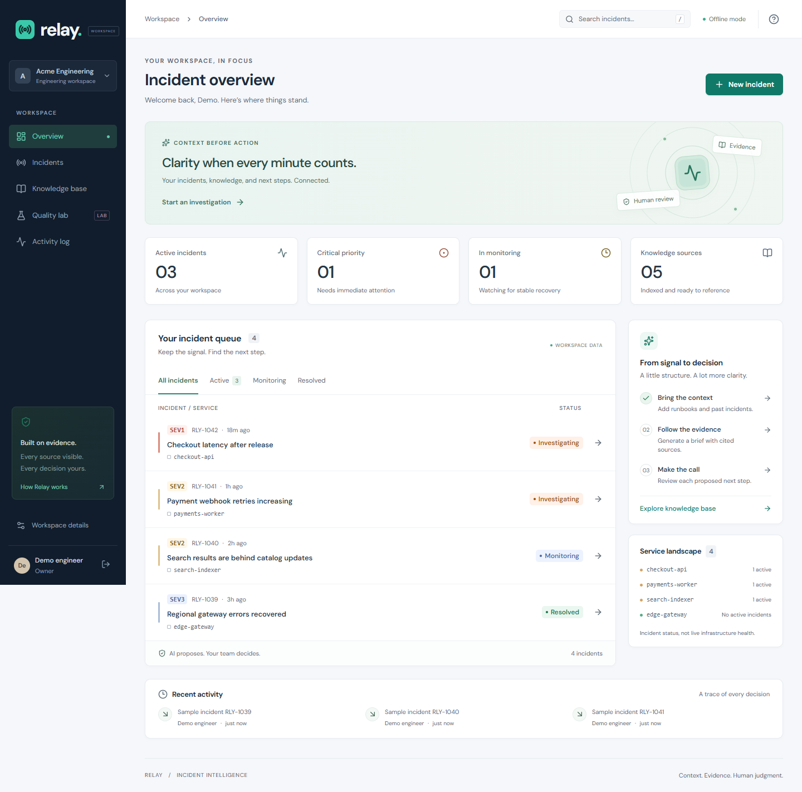
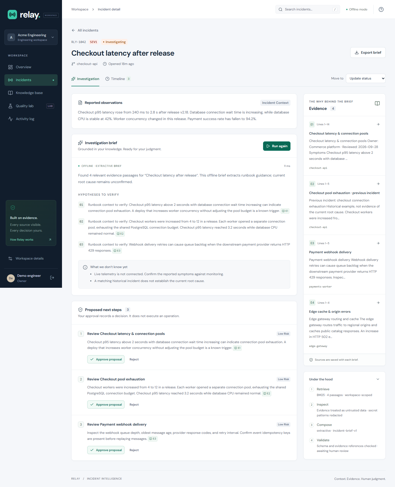

# Relay

[](https://github.com/Mohammadeslamifar1/relay-incident-workspace/actions/workflows/ci.yml)
[](LICENSE)

**Incident investigation with traceable evidence and human-reviewed decisions.**

An evidence-first incident workspace for engineering teams. Relay connects incident observations with runbooks and postmortems, produces a cited investigation brief, and records human decisions about proposed actions.

**React · TypeScript · FastAPI · SQLAlchemy · PostgreSQL / SQLite · OpenAI Responses API**



## Try it locally

This project runs without an API key. The default **extractive mode** retrieves and quotes runbook guidance locally; it is not an LLM. An optional OpenAI adapter provides structured model-generated briefs.

Requirements: Python 3.12+ (tested with 3.14), Node.js 24, npm. Docker is optional.

From a PowerShell terminal in the project folder:

```powershell
git clone https://github.com/Mohammadeslamifar1/relay-incident-workspace.git
cd relay-incident-workspace
python -m venv .venv
.\.venv\Scripts\python.exe -m pip install -c requirements.lock -e ".[dev]"
npm ci --prefix apps/web
npm run build --prefix apps/web
.\.venv\Scripts\python.exe run.py
```

Open **http://127.0.0.1:8000** and choose **Explore the demo workspace**. It creates an isolated workspace with four fictional incidents and five knowledge sources. Alternatively, create an account for an empty workspace. The sample telemetry is illustrative, not connected to live services.

On macOS/Linux, use `.venv/bin/python` instead of `.venv\Scripts\python.exe`.

**In PyCharm:** select `.venv/Scripts/python.exe` as the interpreter, open `run.py`, and click Run. The application is served from one local address; no separate frontend terminal is needed after building. See [the detailed setup guide](docs/SETUP.md), including the Windows native-extension troubleshooting steps.

## The workflow

1. **Capture observations.** Open an incident with a service, severity, and observed symptoms.
2. **Bring knowledge.** Import a `.md`/`.txt` file or paste a runbook, postmortem, or architecture note. Known secret patterns are redacted and duplicate content is detected.
3. **Investigate.** A persisted job retrieves workspace-scoped passages using BM25. The selected provider produces a structured brief. The server validates the schema and citation IDs before publishing it.
4. **Inspect the sources.** Each source includes line references and an immutable snapshot. Hypotheses are explicitly unconfirmed.
5. **Review proposals.** Record an approval or rejection with a rationale. Decisions are immutable through the API. Nothing runs against infrastructure.
6. **Close the loop.** Move from investigating to monitoring to resolved. Export a Markdown handoff with evidence and decisions.



## Engineering decisions

| Concern | Implementation |
| --- | --- |
| Isolation | Every resource lookup and retrieval query is scoped to the authenticated workspace; cross-workspace IDs return 404. |
| Authentication | Argon2 password hashing; 8-hour signed JWT in an HTTP-only, SameSite=Strict cookie; origin and Fetch Metadata checks on writes. |
| Authorization | Owner/analyst writes and viewer read access, enforced on the server. Role provisioning is currently an administrative database task; no invitation flow is claimed. |
| Repeat requests | Database uniqueness on incident + idempotency key prevents duplicate analysis creation for the same key. |
| Concurrent edits | A compare-and-swap version check rejects stale incident updates with 409. |
| Background work | A single application worker drains a persisted queue. Queued work survives restarts; interrupted work fails visibly, avoiding silent retries of paid inference. |
| AI boundaries | Bounded retrieval context, strict structured output, citation-reference validation, abstention without matching evidence, and no execution tools. |
| Traceability | Persisted evidence snapshots, provider/prompt trace, latency, review history, and append-only API audit events. |
| Maintainability | Alembic migrations, dependency locks, typed UI, API tests, browser tests, automated accessibility checks, and CI configuration. |

## Measure the pipeline

The **Quality lab** runs eight synthetic regression cases against a fixed reference corpus and stores the results in the workspace. It reports retrieval recall@3, mean reciprocal rank, abstention accuracy, and citation validity.

```powershell
.\.venv\Scripts\python.exe scripts/evaluate.py
```

These are small regression checks, not a benchmark of real incident-response performance. Citation validity means a reference points to a supplied passage; it does **not** establish that a model's claim is semantically supported. See [evaluation methodology](docs/EVALUATION.md).

## Optional live AI

Copy `.env.example` to `.env` and configure:

```dotenv
RELAY_AI_PROVIDER=openai
RELAY_OPENAI_API_KEY=your-key
RELAY_OPENAI_MODEL=gpt-4.1-mini
```

Restart the server. Incident context and retrieved passages are sent to the configured OpenAI model; API usage may incur costs. Keys stay on the backend. The adapter uses the Responses API, `store=false`, and a strict JSON schema. The live integration has mocked contract tests; a paid live-model call is not part of the local verification.

Official reference: [OpenAI Structured Outputs](https://developers.openai.com/api/docs/guides/structured-outputs?api-mode=responses).

## Development and checks

For frontend hot reload, run these in separate terminals:

```powershell
.\.venv\Scripts\python.exe -m alembic upgrade head
.\.venv\Scripts\python.exe -m uvicorn relay.main:app --reload --host 127.0.0.1 --port 8000
```

```powershell
npm run dev --prefix apps/web
```

Then open http://127.0.0.1:5173. The Vite proxy forwards `/api` to FastAPI. Interactive API documentation is at http://127.0.0.1:8000/docs.

```powershell
.\.venv\Scripts\python.exe -m pytest --cov=relay --cov-report=term-missing
.\.venv\Scripts\python.exe -m black --check apps/api tests scripts migrations run.py
.\.venv\Scripts\python.exe -m isort --check-only apps/api tests scripts migrations run.py
.\.venv\Scripts\python.exe -m flake8 apps/api tests scripts migrations run.py
npm run build --prefix apps/web
npm exec --prefix apps/web -- playwright install chromium
npm run test:e2e --prefix apps/web
```

Browser tests use an isolated temporary SQLite database on port 8001. They do not modify your working database. See [verification notes](docs/VERIFICATION.md) for observed results and limitations.

## Project map

```text
apps/api/relay/     FastAPI routes, persistence, auth, worker, AI and retrieval
apps/web/src/      React application and responsive design
apps/web/e2e/      Playwright user journeys and accessibility checks
migrations/        Versioned Alembic schema
tests/             API, authorization, concurrency and provider contract tests
scripts/           Evaluation, packaging and isolated browser-test server
docs/              Setup, architecture, evaluation, demo and verification
.github/workflows/ Automated verification on pushes and pull requests
run.py             One-click PyCharm application entry point
```

## Deployment and scope

`docker compose up --build` starts the application and PostgreSQL. The container runs as a non-root user and waits for database health. See [deployment guidance](docs/DEPLOYMENT.md) before exposing it outside your machine.

Relay currently targets local use and small, bounded workspaces. It uses a single worker, in-process rate limits, and lexical BM25 retrieval. SSO, invitations, password recovery, vector retrieval, and live monitoring integrations are outside the current scope. Audit rows are protected through API permissions and immutable review endpoints; direct database access remains a separate trust boundary. Public deployment requirements and scaling tradeoffs are documented in the architecture notes.

## Documentation

- [Architecture and tradeoffs](docs/ARCHITECTURE.md)
- [Five-minute demonstration](docs/DEMO.md)
- [Evaluation methodology](docs/EVALUATION.md)
- [Verification record](docs/VERIFICATION.md)
- [Contribution guide](CONTRIBUTING.md)

## Roadmap

- Expand the held-out evaluation corpus with contradictory sources, paraphrases, and adversarial inputs.
- Compare BM25 against hybrid retrieval and measure claim-level support separately from citation validity.
- Add leased worker claims and shared rate limits before supporting multiple application processes.
- Introduce invitation-based membership, session revocation, and cursor pagination.

Maintained by [Mohammad Eslamifar](https://github.com/Mohammadeslamifar1). MIT licensed. All included incidents and company data are fictional.
