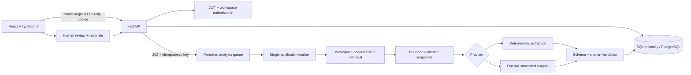

# Architecture and decisions

## Request and analysis flow

## Domain boundaries

One user belongs to one workspace. Incidents, documents, analyses, decisions, evaluations, and audit events carry workspace IDs. Chunks belong to documents; retrieval joins through the scoped parent. The database does not implement row-level security; application authorization is tested directly with cross-workspace requests.

Incident status is a state machine: `investigating → monitoring → resolved`, with monitoring and resolved allowed to return to investigating. Status changes use an expected version and a conditional SQL update. Analysis creation uses a client idempotency key and a unique database constraint. Action reviews have a unique `(analysis_id, action_index)` pair and no update/delete endpoint.

## Why a modular monolith?

A single FastAPI service makes the transaction boundaries and local setup straightforward. The worker, retrieval, provider adapter, auth and domain schemas are separate modules. Splitting these into microservices would add networking and deployment overhead before the workload justifies it. The UI is independently built and uses a typed client with React Query caching.

## Why BM25 first?

Runbooks contain precise service names, error codes and operational terms. A lexical baseline is cheap, inspectable, reproducible and useful without downloading a model. The ranking requires at least two overlapping non-stopword tokens and returns up to five passages. This heuristic is not calibrated confidence and can miss paraphrases. The UI labels scores as relevance.

The next experiment would compare this baseline against dense retrieval and hybrid reciprocal-rank fusion on a larger held-out corpus. Embeddings should be added because they improve measured retrieval, not just to lengthen the technology list.

## Evidence and trust

Documents are normalized by known secret-pattern redaction, deduplicated by SHA-256 of normalized content, and split into line-referenced passages. Retrieved excerpts are snapshotted with the analysis. Deleting a document removes it from future retrieval but keeps historical evidence.

The provider prompt treats incident text and evidence as untrusted data. A small heuristic flags instruction-like content for the trace; it is advisory. The important boundaries are the absence of execution tools, bounded input, structured output validation, allowed evidence IDs, and human review. These measures do not solve prompt injection or prove factual correctness. A semantically unsupported claim can still cite a valid source ID. Reviewer judgment remains necessary.

## Worker and failure semantics

An application lifespan task drains persisted queued analyses, one at a time. On restart, previously running analyses become visibly failed; queued analyses remain eligible. There is no automatic paid-provider retry. A completed result, trace and audit event commit together. Exceptions produce safe error messages without upstream response bodies or API keys.

This worker is explicitly **single process**. Multiple workers can race to claim the same queued row, and startup recovery assumes no other worker is running. Before scaling, introduce a claim/lease protocol (`FOR UPDATE SKIP LOCKED` or a dedicated queue), worker heartbeats, recovery ownership, timeouts, and shared rate limits.

## Security and operational boundaries

- Argon2 password hashes and expiring, signed, HTTP-only cookies. Logout clears the browser cookie; it is not server-side token revocation.
- Mutating browser requests require an allowed Origin and reject cross-site Fetch Metadata. HTTP-only cookies do not replace CSRF controls.
- Owner and analyst roles may write; viewers may read. User invitation, role-management UI, password reset and SSO are intentionally outside this release.
- Workspace queries prevent direct object reference leakage. Request IDs and logs exclude request bodies and secrets.
- Application-level audit immutability is not protection against direct database edits.
- In-process rate limits and request/document size limits bound normal use. Workspace count, demo lifetime, aggregate database growth and concurrent quota enforcement require stronger limits for a public deployment.
- The SQLite development default and all container ports are local. Public deployment needs HTTPS, secure cookies, a stable secret, restricted origins, disabled demo provisioning, backups, and controlled registration.

## Known tradeoffs

The application lists at most 200 incidents/audit events and 20 analyses/evaluation runs per resource. It does not yet expose cursor pagination. Retrieval currently loads workspace chunks in memory and performs CPU work in the application worker, so it is sized for the bounded portfolio corpus, not large-scale indexing. There is no production SLA, live infrastructure integration, or measured incident-resolution time improvement.
